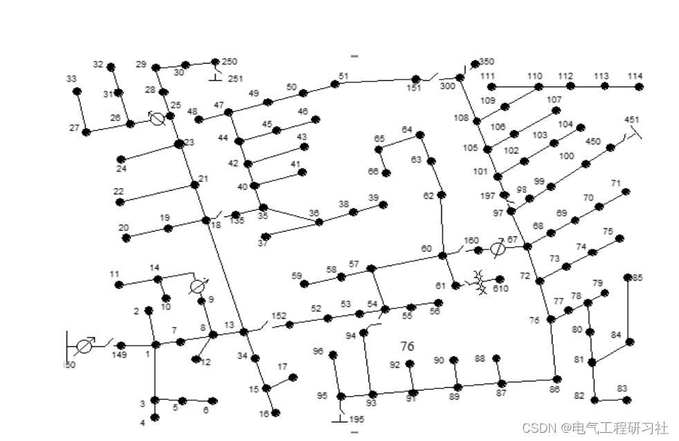
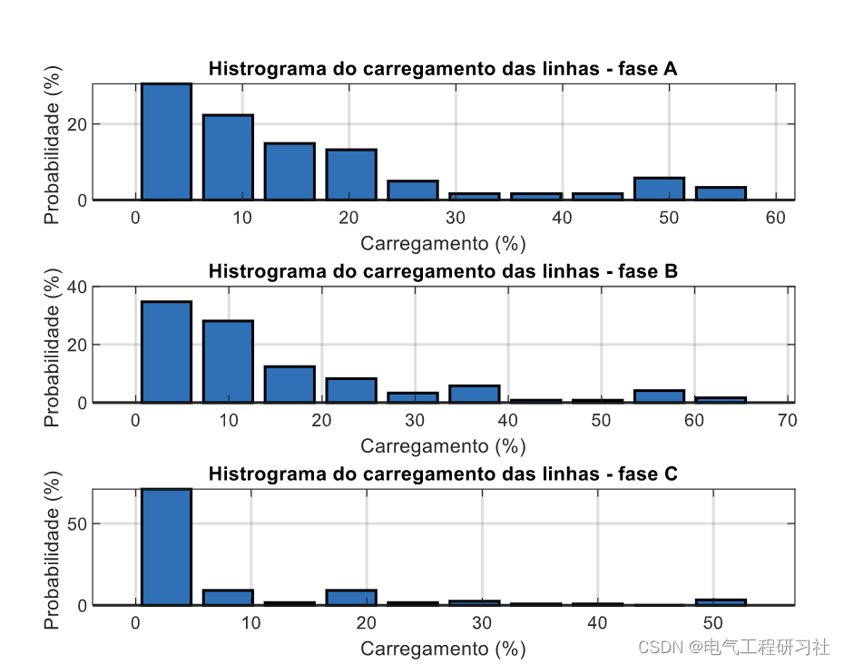
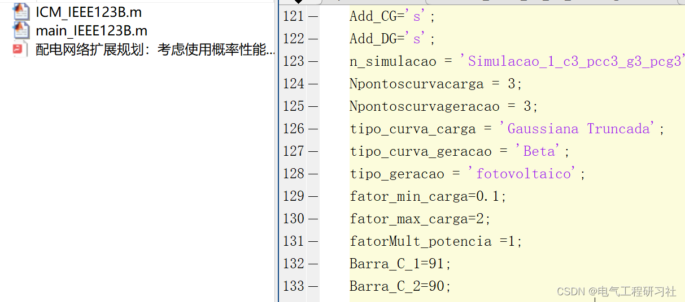

# Expansion Planning of Power Distribution Network: Decision Considering Probabilistic Energy Production and Consumption Situation (Matlab Code Implementation)

1. Overview of the Electric Power System (EPS) continuously expanding to meet consumer demand for electricity. In this context, the Extended Planning for Distribution Systems (PESD) plays a role in determining guidelines for the expansion of the distribution network. Besides the expansion of SEP, the modernization and emergence of new technologies such as Distributed Generation (DG) also affect the quality and reliability of the power system, affecting the distribution network. There are several factors that influence the energy distribution network, such as the addition of new consumers, increased energy consumption, changes in load curves, and the increase in DG. In this case, energy distributors seek to optimize the technology developed by PESD and formulate repowering plans for distribution lines (replacing current capacity with larger elements), which have already exceeded their work plan. Therefore, the purpose of this work is to propose adjustments to the technical planning method to consider random curves of energy generation and consumption. In the case study conducted, the current load can be calculated and the voltage in the bus can be found, thereby estimating the replacement of cables that carry more than 66% of the load. Additionally, after simulating the flow pattern and arranging the generation points and consumption points, the cost of repowering the entire network can be calculated.
This article is divided into three parts: The first part introduces the relevant mathematical models. The second part introduces methods for evaluating the impact of load and generation changes on the distribution network. Finally, in the final part, the simulation of probability aspects is introduced.
2 Mathematical Models
Detailed mathematical models are described in Part Four.
3 Case Simulation
Edit
4 Matlab Code and Article Reading
The code in this article has been completed 80%, but it is not ready for debugging, please click here:
Not recommended for students who are not good at programming.
Edit

## Images

<!-- PAYMENT_BLOCK -->

## Get this dataset

- Payment link (Stripe): [Buy now](https://buy.stripe.com/3cs8yP7sY87d0vu9AB)
- Payment QR code: 

<!-- /PAYMENT_BLOCK -->
